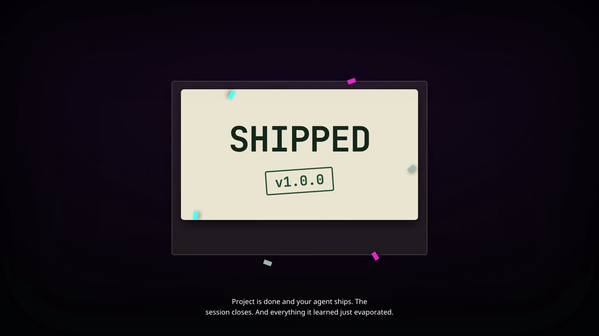

# GoneBy — Retroactive Project Memory for LLM Agents

GoneBy is a library, MCP server, and Hermes plugin that captures LLM project
output every turn into an encrypted write-ahead log, then retroactively
filters and stores what actually mattered — judged backward from the shipped
product — for semantic search in later sessions.

**→ Setting up the full stack from zero (llama.cpp, the embedding model,
Valkey, keys, smoke test): [`docs/SETUP.md`](docs/SETUP.md).**
**→ Full documentation of the mechanism, benefits, and every user option:
[`docs/OVERVIEW.md`](docs/OVERVIEW.md).**

## Watch

[](https://github.com/rahlquist/goneby/releases/download/v1.0.0/goneby-explainer.mp4)

*The Rewind* — the problem, the backward walk, and the four phases, narrated
and captioned. [Release asset (MP4, 13 MB)](https://github.com/rahlquist/goneby/releases/tag/v1.0.0)

## How It Works

1. **Capture (WAL):** Every turn is appended to an encrypted per-project
   Write-Ahead Log at `pre_llm_call` boundaries — before the host compacts
   the transcript, so nothing is lost to the rewrite. No filtering, no LLM
   calls — just append.
2. **Filter (Backward Walk):** At project close, walk backward through the WAL using the shipped product as the oracle to determine which entries were actually relevant.
3. **Store (Embed + Vector DB):** Embed the surviving entries and upsert them into Valkey (default) or Qdrant.
4. **Retrieve:** Future sessions query the store semantically.

The capture phase costs zero tokens. All inference is deferred to the single backward-walk pass and the embedding call at store time.

## Requirements

| Component | Requirement | Notes |
|-----------|-------------|-------|
| Python | 3.11+ | |
| Encryption key | 32 bytes | `goneby generate-key` |
| Embedding server | Any OpenAI-compatible `/v1/embeddings` | llama.cpp recommended |
| Vector store | Valkey (default) or Qdrant | |

### Embedding server

GoneBy talks to any server exposing `POST /v1/embeddings`. Recommended: **Qwen3-Embedding-0.6B** via llama.cpp, running locally.

```bash
# Start the embedding server (CPU is fine for this model size)
llama-server \
  -m ~/models/Qwen3-Embedding-0.6B-Q8_0.gguf \
  --embedding \
  --host 127.0.0.1 \
  --port 8081 \
  -c 4096
```

No `--pooling` flag is needed — the pooling type ships in the GGUF metadata.
Get llama.cpp and the model from the URLs in
[`docs/SETUP.md`](docs/SETUP.md) §3.

Verify:

```bash
curl http://localhost:8081/v1/models
goneby status
```

**MRL (Matryoshka truncation).** The model emits 1024 dimensions. GoneBy truncates to
`GONEBY_EMBEDDING_DIMENSIONS` (default 512) and renormalizes, halving storage while
retaining ~97% of retrieval quality. Raise it to 1024 for maximum fidelity; drop to 256
for large stores. Truncation happens before normalization so the stored vectors are
unit-length and cosine similarity is a plain dot product.

## Quick Start

```bash
uv venv .venv && uv pip install --python .venv/bin/python -e ".[mcp,valkey,qdrant]"

export GONEBY_ENCRYPTION_KEY=$(.venv/bin/goneby generate-key | head -1 | awk '{print $NF}')
goneby status
goneby serve
```

## Configuration

| Variable | Default | Description |
|----------|---------|-------------|
| `GONEBY_ENCRYPTION_KEY` | (required) | 32-byte hex key for ChaCha20-Poly1305 |
| `GONEBY_WAL_PATH` | `~/.goneby/wal` | Path to the encrypted WAL |
| `GONEBY_PROJECT` | `default` | Project namespace for stored memories |
| `GONEBY_VECTOR_BACKEND` | `valkey` | `valkey` or `qdrant` |
| `GONEBY_VALKEY_HOST` / `_PORT` / `_DB` | `localhost` / `6379` / `0` | Valkey connection |
| `GONEBY_QDRANT_HOST` / `_PORT` | `localhost` / `6333` | Qdrant connection |
| `GONEBY_QDRANT_COLLECTION` | `goneby` | Qdrant collection |
| `GONEBY_EMBEDDING_BASE_URL` | `http://localhost:8081/v1` | Embedding server |
| `GONEBY_EMBEDDING_MODEL` | `qwen3-embedding-0.6b` | Model name sent to the server |
| `GONEBY_EMBEDDING_API_KEY` | (none) | Bearer token, for hosted embedders |
| `GONEBY_EMBEDDING_DIMENSIONS` | `512` | MRL truncation target |
| `GONEBY_EMBEDDING_BATCH_SIZE` | `16` | Texts per request |

## MCP Tools

| Tool | Purpose |
|------|---------|
| `wall_append(content, entry_type)` | Append to the encrypted WAL — call at each compaction. Zero token cost. |
| `wall_read()` | Review all captured entries |
| `walk_backward(mvp_text)` | Filter the WAL against the shipped product. Returns kept entries + stats. |
| `store_memory(entries)` | Embed and upsert walked entries. Idempotent — IDs are content-derived. |
| `query_memory(query, top_k, min_score)` | Semantic search over stored memories |
| `generate_key()` | Generate a new encryption key |
| `status()` | Config, WAL stats, and a live health probe of both backends |

### Typical session

```
wall_append(<output since last compaction>, entry_type="note")
... work continues ...
walk_backward(<shipped MVP description>)   # at project close
store_memory(<kept_entries>)
query_memory(<question in a later session>)
```

## Hermes plugin

GoneBy ships a Hermes plugin that makes capture and recall **automatic** — the agent does not have to remember to call anything.

```
~/.hermes/plugins/goneby/
├── plugin.yaml      # manifest: declares tools + hooks
├── __init__.py      # register(ctx)
├── adapter.py       # tools, hooks, capture/recall logic
└── pyproject.toml   # declares the goneby dependency for PM
```

Install by copying the `plugin/` directory to `~/.hermes/plugins/goneby/`, then:

```bash
hermes plugins validate ~/.hermes/plugins/goneby   # expect overall ok: True
hermes plugins enable goneby
```

### What the hooks do

| Hook | Behavior |
|------|----------|
| `pre_llm_call` | Captures messages not yet seen into this project's WAL (skips `system`/`tool` roles). Also performs recall when `GONEBY_AUTO_RECALL=true`. |
| `post_compaction` | Records a compaction-boundary marker so the WAL reflects the project's shape. |

Capture is per-turn rather than per-compaction: `post_compaction` fires *after* the transcript is rewritten, so the dropped messages are already gone. `pre_llm_call` hands us the full `conversation_history` before that happens, which is a superset and loses nothing.

Capture is idempotent — messages are keyed on `message_uid` when present, else a role+content hash — so a turn that appears in several `pre_llm_call` payloads is stored once.

### Configuration (plugin)

| Variable | Default | Description |
|----------|---------|-------------|
| `GONEBY_AUTO_CAPTURE` | `true` | Capture turns into the WAL automatically |
| `GONEBY_AUTO_RECALL` | `false` | Inject relevant memories into every turn |
| `GONEBY_RECALL_MIN_CHARS` | `12` | Skip recall for turns shorter than this |
| `GONEBY_RECALL_TOP_K` | `3` | Memories injected per turn when recall is on |

`GONEBY_AUTO_RECALL` defaults **off** because a semantic search on every turn costs latency; the agent already has `query_memory`.

### Project isolation

Each project writes its own WAL (`~/.goneby/wal/<project>.wal`), so a backward walk for one project never sees another's evidence. Retrieval is scoped by default; pass `scope="all"` for deliberate cross-project lookup.

The project name comes from `GONEBY_PROJECT`. To key on the working directory instead, point it at a stable slug — the plugin flattens paths safely.

### Tools

The same six tools the MCP server exposes, registered as first-class Hermes tools: `wall_append`, `wall_read`, `walk_backward`, `store_memory`, `query_memory`, `goneby_status`.

`walk_backward` judges relevance through `ctx.llm.complete_structured` — it borrows the user's active model and auth, so there is no separate API key and no hardcoded provider.

## Security

- WAL entries are encrypted independently with ChaCha20-Poly1305 and a random 96-bit nonce, then base64-encoded one per line. Append-only — existing entries are never rewritten.
- A wrong key or damaged line yields a `CORRUPTED` marker rather than aborting the read or leaking plaintext.
- **Losing the key means losing the WAL.** Store it in Bitwarden or the Hermes vault, not in the repo.

## Capture policy

Capture is **on for everything by default** (`mode=all`), with four controls —
most specific wins:

| Control | Scope | Set via |
|---|---|---|
| **master gate** | everywhere, persisted | `/goneby gate on\|off`, `goneby gate on\|off`, `~/.goneby/config.json` |
| **platform kill** | one gateway (`telegram`, `discord`, `cli`, `desktop`...) | `/goneby platform telegram off`, `goneby platform disable telegram`, `GONEBY_DISABLED_PLATFORMS=telegram,discord` (env is additive, not persisted) |
| **project marker** | one repo — `.goneby.json` at the project root, team-visible, travels with the repo | `/goneby enable [path]`, `/goneby disable [path]`, `goneby project enable PATH`, `goneby_project` tool |
| **user override** | one project, personal — `~/.goneby/config.json` `projects` map (used when no marker exists or the repo isn't writable) | `goneby project enable --project SLUG`, `goneby_project` tool fallback |

Switching the whole system to disable-by-default: `/goneby mode opt-in` or
`goneby mode opt-in` — then only projects with an enabling marker/override
capture. `mode all` (default) captures everything not excluded above.

**Project identity**: the plugin resolves a session's project from Hermes'
`state.db` (`sessions.git_repo_root`, falling back to `sessions.cwd`) — the
repo directory name becomes the WAL slug, so per-project WALs are real, not
aspirational. Sessions with no resolvable context fall back to
`GONEBY_PROJECT`/`default`. `GONEBY_HERMES_STATE_DB` overrides the lookup path.

Everything persists in `~/.goneby/config.json` (`GONEBY_CONFIG_PATH` to move
it). `goneby_status` and `/goneby status` show the effective decision.

## Architecture

```
┌──────────────────────────────────────────────────────────────┐
│                    LLM Agent (Hermes)                         │
│   context full → wall_append() → context compacted            │
└───────────────────────────┬──────────────────────────────────┘
                            │ zero token cost
                            ▼
              ┌──────────────────────────────┐
              │  Encrypted WAL (ChaCha20)    │  append-only
              └──────────────┬───────────────┘
                             │ at project close
                             ▼
   Shipped MVP ──► Backward Walk ──► LLM Judge ──► Deduplicate
   (oracle)         newest → oldest
                             │
                             ▼
              ┌──────────────────────────────┐
              │ Qwen3-Embedding-0.6B         │  MRL → 512 dims
              │ llama.cpp :8081              │  local, no API cost
              └──────────────┬───────────────┘
                             ▼
              ┌──────────────────────────────┐
              │ Valkey (default) | Qdrant    │  cosine search
              └──────────────────────────────┘
```

Full diagram: `docs/architecture.html` (open in any browser).

## Development

```bash
uv pip install --python .venv/bin/python -e ".[mcp,valkey,qdrant,dev]"
.venv/bin/python -m pytest tests/ -q
.venv/bin/python -m ruff check .
```

The test suite runs a fake OpenAI-compatible embedding server, so no model or vector
database is required. The fake is **not** semantic — it validates plumbing (batch
ordering, MRL truncation, normalization, round trips, idempotency), not retrieval
quality. Verify ranking against a real model before trusting it.

`scripts/live_check.py` exercises the embedder plumbing (batching, MRL,
normalization, round trips) against a **fake** vector server on :8081 —
it validates transport, not ranking quality.

## Deployment guidance

GoneBy has three moving parts: the **embedding server**, the **vector
backend**, and (for Hermes users) the **plugin**. Run the first two as
long-lived local services however your machine supervises services — a
systemd user unit, docker compose, launchd, or plain `nohup` all work.
Example systemd user unit for a llama.cpp embedder:

```ini
# ~/.config/systemd/user/goneby-embedder.service
[Unit]
Description=GoneBy embedding server
[Service]
ExecStart=%h/llama.cpp/llama-server -m %h/models/qwen3-embedding.gguf \
  --embedding --host 127.0.0.1 --port 8081 -c 4096
Restart=on-failure
[Install]
WantedBy=default.target
```

Guidelines that matter more than the exact paths:

- **Bind everything to `127.0.0.1`.** The embedder and valkey are local
  services; valkey additionally runs with `--protected-mode yes`.
- **Point Hermes at the config** via `GONEBY_*` variables in
  `~/.hermes/.env` (Hermes' own env file, mode 600), including
  `GONEBY_ENCRYPTION_KEY` — generated with `goneby generate-key` and
  recorded nowhere else. Losing it means losing every WAL.
- **CPU is sufficient** for the recommended 0.6B embedding model.
- `goneby status` probes the whole chain (config + live embedder) — make it
  part of any health check.

### Plugin path source (Hermes)

`plugin/pyproject.toml` declares `goneby` as a `tool.uv.sources` **path**
dependency, because it is not on PyPI yet. Hermes' admission resolver
(`uv lock`) needs that declaration, and it must be an **absolute path to
your checkout** — e.g. `<your-checkout>/goneby`. Set it once after cloning;
`hermes plugins enable goneby` then installs and enables cleanly.

### Verified reference deployment

A full local deployment (llama.cpp + Qwen3-Embedding-0.6B Q8_0 + valkey,
plugin enabled on a live gateway) was verified end-to-end on 2026-11-10:
real-model ranking margin related/unrelated cosine 0.67/0.25, correct top
hit, project-scoped isolation proven against the store, WAL ciphertext at
rest. The unit suite uses a fake embedder and validates plumbing, not
ranking — always sanity-check ranking with `goneby status` plus a real
query when you stand a new machine up.

## License

Apache 2.0
